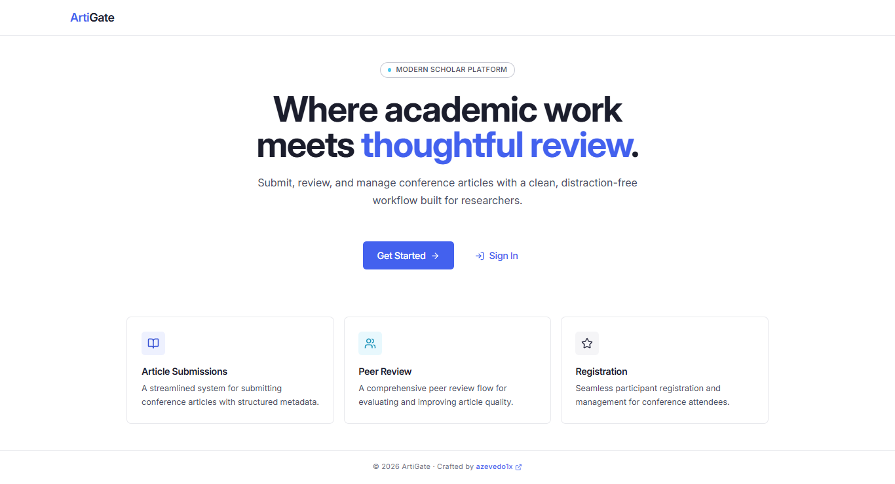
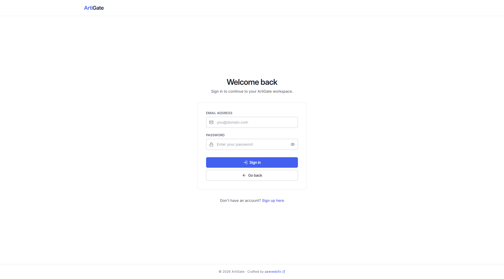
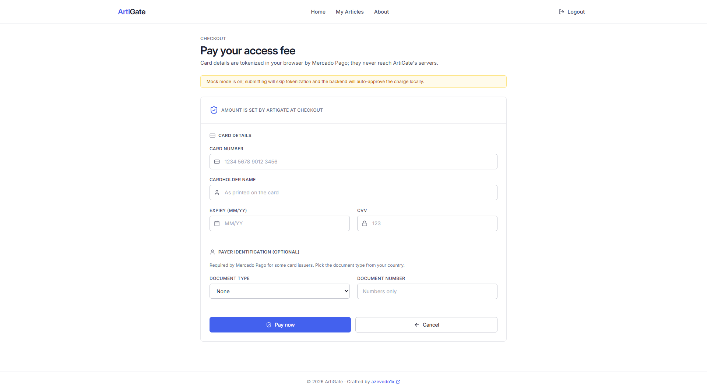
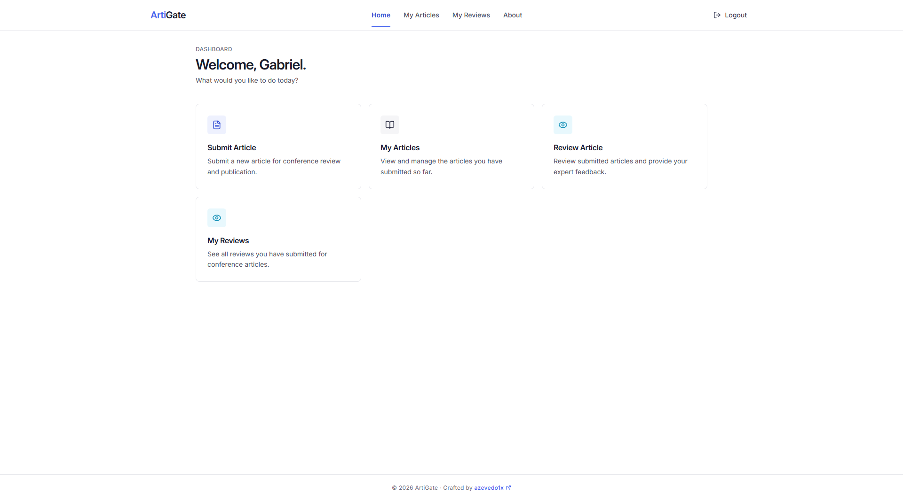
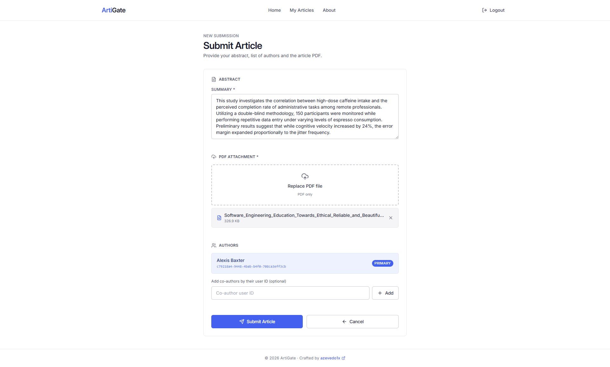
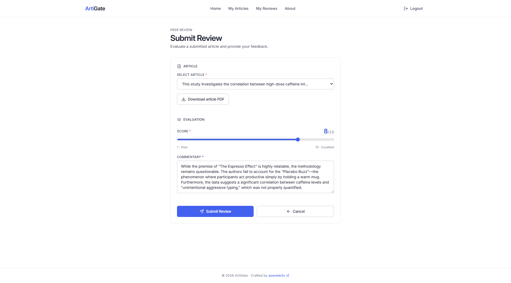
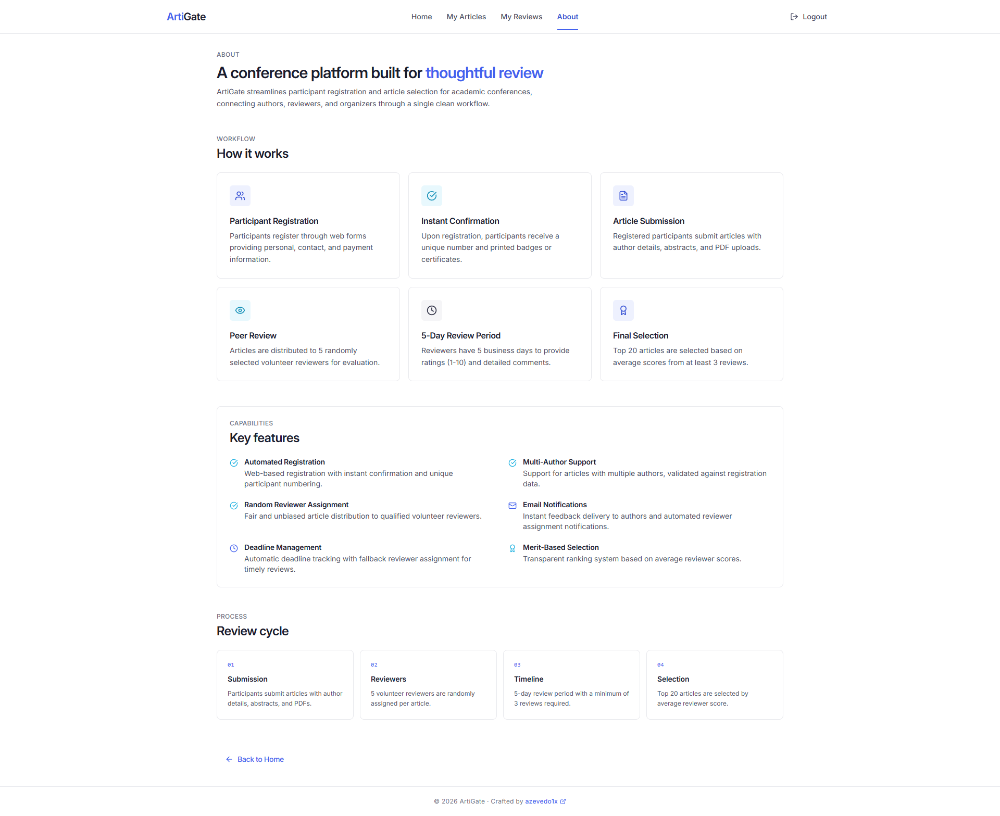

<h1 align="center">
  
</h1>

<p align="center">
  Open source platform for academic events: participant registration, access fee payment, paper submission and peer review in a single workflow.
</p>

<p align="center">
  
  
  
  
  
  
  
</p>

---

## Table of contents

- [The problem](#the-problem)
- [What ArtiGate provides](#what-artigate-provides)
- [How it works](#how-it-works)
- [Use cases](#use-cases)
- [Getting started](#getting-started)
- [Configuration reference](#configuration-reference)
- [Access control](#access-control)
- [API overview](#api-overview)
- [Architecture](#architecture)
- [Tech stack](#tech-stack)
- [Testing and code quality](#testing-and-code-quality)
- [Known limitations](#known-limitations)
- [Project status](#project-status)
- [Contributing](#contributing)
- [License](#license)

## The problem

Small and mid-sized academic conferences often manage their submission cycle with spreadsheets, e-mail attachments and manual payment checks. That process makes it hard to answer basic questions reliably: who has paid the registration fee, which papers were submitted, which file is the latest version, and who is allowed to review what.

ArtiGate centralizes that cycle in one self-hosted application. It enforces the event rules in code (payment before submission, no self-review, one review per reviewer) instead of relying on organizers to check them by hand.

## What ArtiGate provides

- **Participant registration and authentication.** Sign-up with home and work addresses, JWT-based sign-in and bcrypt-hashed passwords. Brazilian postal codes (CEP) are auto-completed through [BrasilAPI](https://brasilapi.com.br).
- **Access fee payment.** Card payments through [Mercado Pago](https://www.mercadopago.com.br/developers), with card data tokenized in the browser so the backend never receives the card number or CVV. Charges are idempotent and status updates arrive through HMAC-SHA256 signed webhooks.
- **Paper submission.** Each article has a summary, one to three authors and a mandatory PDF attachment.
- **Hardened PDF handling.** Uploads are validated by magic bytes and structure (not by file extension), stored outside the web root with a SHA-256 checksum, and served back with restrictive headers (`Content-Security-Policy: sandbox`, `nosniff`, `no-store`).
- **Peer review.** Reviewers score articles from 1 to 10 and leave a comment. Authors cannot review their own articles, each reviewer can review an article only once, and the article's average score is recomputed on every review.
- **Role-based access.** `AUTHOR` and `REVIEWER` roles, with reviewer-only pages for submitting and tracking reviews.
- **Local development without a payment provider.** A mock payment gateway (`ENABLE_PAYMENT_MOCK=true`) approves payments locally so the full workflow can run without Mercado Pago credentials.
- **Interactive API documentation.** Swagger UI is served at the API root.

## How it works

```
sign up  →  pay the access fee  →  submit an article (summary + authors + PDF)  →  reviewers score and comment
```

1. A participant creates an account. Accounts created through the sign-up page always receive the `AUTHOR` role; the `REVIEWER` role is optional.
2. Before submitting or reviewing, the participant pays the access fee on the checkout page. Access is unlocked once the payment status is `approved`.
3. Authors submit articles and follow the reviews they receive on **My Articles**, where the PDF can also be downloaded.
4. Reviewers see the articles they are allowed to review, submit a score and commentary, and track their own reviews on **My Reviews**.

### Screenshots

| | |
|---|---|
| **Landing**  | **Login**  |
| **Checkout**  | **Dashboard**  |
| **Submit Article**  | **Submit Review**  |
| **About**  | |

## Use cases

- Academic conferences, symposiums and workshops that charge a registration fee and run a peer-review round.
- Student research events and internal university events that need a simple, self-hosted submission system.
- Developers looking for a reference implementation of a NestJS + React application with Clean Architecture, payment webhooks and secure file uploads.

## Getting started

### Prerequisites

- **Node.js** `^20.19.0` or `>=22.12.0` (required by Vite 8 and NestJS 11) and **npm**
- **SQL Server** instance reachable from the backend
- **Mercado Pago** account and credentials, only if you want real payments (not needed in mock mode)

### 1. Clone and install

```bash
git clone https://github.com/azevedo1z/ArtiGate.git
cd ArtiGate
npm install
```

### 2. Configure the backend

Copy the example file to `.env` in the repository root and fill in the values:

```bash
cp .env.example .env
```

At minimum, set `DATABASE_URL` and a `JWT_SECRET` with at least 32 characters. To run without Mercado Pago, set `ENABLE_PAYMENT_MOCK=true`; the Mercado Pago variables then become optional. The backend validates the environment at startup and refuses to boot if a required value is missing. See the [configuration reference](#configuration-reference) for every variable.

### 3. Configure the frontend

The frontend reads its settings from `frontend/.env.development`, which is versioned with defaults for local development (API at `http://localhost:3000`, payment mock enabled). To override them without changing the tracked file, create `frontend/.env.local` (ignored by Git).

When the backend runs with real Mercado Pago credentials, set `VITE_ENABLE_PAYMENT_MOCK=false` and `VITE_MERCADO_PAGO_PUBLIC_KEY` to your public key, so both sides use the same payment mode.

### 4. Set up the database

```bash
npx prisma migrate dev
npx prisma db seed
```

The seed creates the `AUTHOR` and `REVIEWER` roles. It is required: sign-up fails if these roles do not exist.

### 5. Run the applications

In two terminals:

```bash
npx nx serve backend-api
```

```bash
npx nx serve frontend
```

| Application | URL |
|---|---|
| Frontend (Vite) | http://localhost:3001 |
| Backend API (NestJS) | http://localhost:3000 |
| Swagger UI | http://localhost:3000/ |

### 6. Try the workflow

1. Open http://localhost:3001 and sign up, selecting the **Reviewer** role if you want to test reviews.
2. Pay the access fee on the checkout page. In mock mode the payment is approved locally.
3. Submit an article with a PDF, then sign in with a second reviewer account to review it (authors cannot review their own articles).

## Configuration reference

### Backend (`.env` in the repository root)

| Variable | Required | Default | Description |
|---|---|---|---|
| `DATABASE_URL` | Yes | | SQL Server connection string used by Prisma. |
| `JWT_SECRET` | Yes | | Secret used to sign JWTs. Minimum of 32 characters. |
| `JWT_EXPIRES_IN` | Yes | | Token lifetime, for example `1d`. |
| `CORS_ORIGIN` | Yes | | Allowed frontend origin, for example `http://localhost:3001`. |
| `PORT` | No | `3000` | HTTP port of the API. |
| `BCRYPT_SALT_ROUNDS` | No | `10` | bcrypt cost factor for password hashing. |
| `BRASIL_API_BASE_URL` | No | `https://brasilapi.com.br` | Base URL for postal code (CEP) lookup. |
| `UPLOAD_DIR` | No | `uploads/articles` | Directory for uploaded PDFs, relative to the process working directory. |
| `MAX_PDF_BYTES` | No | `10485760` (10 MB) | Maximum PDF size, between 1 KB and 50 MB. |
| `ENABLE_PAYMENT_MOCK` | No | `false` | When `true`, uses the local mock gateway instead of Mercado Pago. |
| `PAYMENT_DEFAULT_CURRENCY` | No | `BRL` | Three-letter currency code for charges. |
| `MERCADO_PAGO_ACCESS_TOKEN` | When mock is off | | Mercado Pago private access token. |
| `MERCADO_PAGO_PUBLIC_KEY` | When mock is off | | Mercado Pago public key. |
| `MERCADO_PAGO_WEBHOOK_SECRET` | When mock is off | | Secret used to verify the webhook signature. |
| `MERCADO_PAGO_NOTIFICATION_URL` | When mock is off | | Public URL of `POST /payment/webhook`. Must be reachable by Mercado Pago. |

### Frontend (`frontend/.env.development` or `frontend/.env.local`)

| Variable | Description |
|---|---|
| `VITE_API_BASE_URL` | Backend URL. Falls back to `http://localhost:3000` in development and is mandatory in production builds. |
| `VITE_ENABLE_PAYMENT_MOCK` | `true` to use the mock checkout flow. Keep it consistent with the backend's `ENABLE_PAYMENT_MOCK`. |
| `VITE_MERCADO_PAGO_PUBLIC_KEY` | Mercado Pago public key used to tokenize cards in the browser. |

## Access control

Access is enforced in layers: authentication, then an approved access fee, then role.

| Layer | What it protects | Enforced by |
|---|---|---|
| Authentication | Every page and endpoint beyond the public ones | JWT bearer token, `AuthGuardService` (API) and `PrivateRoute` (UI) |
| Access fee | Article and review endpoints and pages | `AccessFeePaymentGuard` (API) and `RequireAccessFee` (UI) |
| Role | Reviewer pages and PDF download by non-authors | `RoleProtectedRoute` (UI) and the attachment download service (API) |

### Frontend routes

| Route | Page | Access |
|---|---|---|
| `/` | Landing | Public |
| `/login` | Login | Public |
| `/signup` | Sign up | Public |
| `/about` | About | Public |
| `/checkout` | Access fee checkout | Authenticated |
| `/home` | Dashboard | Authenticated, fee approved |
| `/submit-article` | Submit article | Authenticated, fee approved |
| `/my-articles` | My articles | Authenticated, fee approved |
| `/submit-review` | Submit review | Authenticated, fee approved, `REVIEWER` |
| `/my-reviews` | My reviews | Authenticated, fee approved, `REVIEWER` |

## API overview

The complete, interactive contract is available in Swagger UI at the API root. Summary of the modules:

| Module | Main endpoints | Access |
|---|---|---|
| `user` | `POST signIn`, `POST create`, `PUT update`, `DELETE :id`, `GET all`, `GET me`, `GET :id` | Sign-in and sign-up are public; users can only update or delete their own account |
| `role` | `GET all`, `GET me`, `GET :id` | Read-only |
| `address` | `GET :id` | Authenticated |
| `zip-code` | `GET :zipCode` | Postal code lookup |
| `payment` | `POST create`, `GET me`, `GET access-status`, `GET :id`, `POST webhook` | Authenticated, except the signed webhook |
| `article` | `POST create` (multipart with PDF), `PUT update`, `DELETE :id`, `GET all`, `GET me`, `GET reviewable`, `GET :id`, `GET :id/attachment` | Authenticated, fee approved |
| `review` | `POST create`, `PUT update`, `DELETE :id`, `GET all`, `GET me`, `GET article/:articleId`, `GET :id` | Authenticated, fee approved |

Requests are rate limited per client: 5 per minute for sign-in, sign-up and article submission; 30 per minute for PDF downloads; 120 per minute for the payment webhook; 60 per minute for every other route.

## Architecture

ArtiGate is an [Nx](https://nx.dev) monorepo with two applications and a shared database schema:

```
ArtiGate/
├── backend-api/        NestJS API
│   └── src/app/
│       ├── domain/          Entities and value objects, no framework dependencies
│       ├── application/     DTOs and one service per use case
│       ├── interface/       Controllers, repository and gateway ports
│       ├── infrastructure/  Prisma repositories, Mercado Pago, BrasilAPI, PDF storage, guards
│       ├── modules/         NestJS module wiring per feature
│       └── shared/          Config, constants, filters, exceptions
├── backend-api-e2e/    End-to-end test project
├── frontend/           React SPA (Vite, Redux Toolkit, Tailwind CSS)
├── prisma/             Schema, migrations and seed
└── docs/               Logo and screenshots
```

The backend follows Clean Architecture: dependencies point inward, and external services (database, payment gateway, postal code lookup) are accessed through ports, which allows swapping implementations such as the mock payment gateway. Deletions are soft deletes: records receive a `deletedOn` timestamp and are filtered out of queries. Primary keys are UUIDs.

## Tech stack

| Area | Technology |
|---|---|
| Backend | NestJS 11, Prisma 6, SQL Server, Passport JWT, bcrypt, class-validator, Joi, `@nestjs/throttler`, Swagger |
| Frontend | React 18, React Router 6, Redux Toolkit, Axios, Tailwind CSS, Vite |
| Payments | Mercado Pago SDK 2.x, plus a mock gateway for local development |
| External services | BrasilAPI (postal code lookup) |
| Tooling | Nx, TypeScript, Jest, ESLint, Prettier |

## Testing and code quality

```bash
npx nx run-many -t test        # unit tests (Jest)
npx nx run-many -t lint        # ESLint
npx nx run-many -t typecheck   # TypeScript type checking
```

Run a single project with `npx nx test backend-api` or `npx nx test frontend`. Unit tests currently cover the article, attachment, review, payment and postal code services and the PDF security validator.

Nx caches these targets. If results look stale, clear the cache with `npx nx reset`.

## Known limitations

These points reflect the current implementation and are good candidates for contributions:

- **Single event.** The data model has no concept of multiple conferences or editions; one deployment serves one event.
- **Self-assigned reviewer role.** Users choose the `REVIEWER` role themselves; there is no organizer approval or reviewer assignment step.
- **No administration interface.** There is no organizer dashboard for managing users, payments or submissions.
- **SQL Server only.** The Prisma schema targets SQL Server.
- **Local file storage.** PDFs are stored on the server's file system (`UPLOAD_DIR`), which requires a persistent volume in containerized or multi-instance deployments.
- **End-to-end tests.** The `backend-api-e2e` project contains only the initial Nx scaffold and does not exercise the API yet.
- **No deployment tooling.** The repository does not include Dockerfiles or CI pipelines.

## Project status

ArtiGate is in early development (version `0.0.x`, no tagged releases). The core workflow of registration, payment, submission and review is implemented, and the API may still change between versions. Dependencies are kept up to date through automated update pull requests.

## Contributing

Contributions of all sizes are welcome: bug reports, documentation fixes, tests and new features. The [contributing guide](CONTRIBUTING.md) covers the development setup, the project conventions and the pull request checklist.

- **Found a bug?** Open a [bug report](https://github.com/azevedo1z/ArtiGate/issues/new?template=bug_report.yml).
- **Have an idea?** Open a [feature request](https://github.com/azevedo1z/ArtiGate/issues/new?template=feature_request.yml). The [known limitations](#known-limitations) are a good starting point.
- **Found a security issue?** Do not open a public issue; follow the [security policy](SECURITY.md).

## License

ArtiGate is released under the [MIT License](LICENSE).
